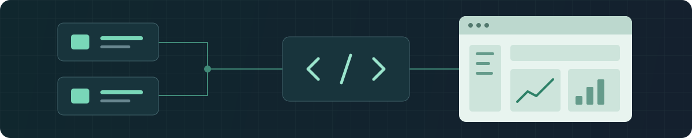

<strong>SENIOR FRONTEND DEVELOPER</strong>

# Mostafa Elsayed

I build production interfaces with **React, Next.js, and TypeScript**.

**6 years of experience** across ERP, B2B, and e-commerce products, with a focus on frontend architecture, performance, and accessible user experiences.

[LinkedIn](https://www.linkedin.com/in/mostafa-elsayed6768) · [Email](mailto:moelsayed6768@gmail.com)

## How I build

- **Maintainable foundations:** reusable components, clear state management, and REST API integration.
- **Thoughtful interfaces:** responsive layouts, multilingual experiences, and accessible interactions.
- **Quality in delivery:** performance optimization, unit and component testing, and code reviews.

## Core toolkit

  
  &nbsp;
  
  &nbsp;
  
  &nbsp;
  

  
  &nbsp;
  
  &nbsp;
  
  &nbsp;
  

**Frontend** · React · Next.js · TypeScript · JavaScript  
**State and APIs** · Redux Toolkit · REST APIs · Axios · i18next  
**UI** · Tailwind CSS · Material UI · shadcn/ui  
**Quality** · Jest · React Testing Library · Web Vitals

---

[Connect on LinkedIn](https://www.linkedin.com/in/mostafa-elsayed6768) · [moelsayed6768@gmail.com](mailto:moelsayed6768@gmail.com)
